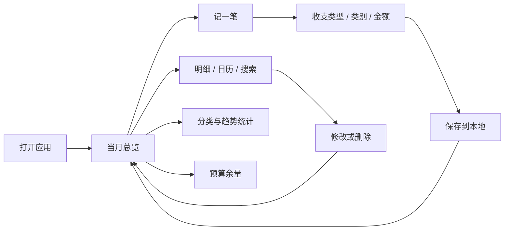

# 鲨鱼记账功能调研

调研日期：2026-11-04（中国标准时间） · 对象：官方鲨鱼记账 Android / iOS 普通版、iOS Pro · 方法：官网、开发者在应用商店发布的介绍；图表栏目补充参考有明确体验环境的历史体验报告及教程，并单独标注证据等级。未安装登录实测，未购买会员；下文的“已确认”仅代表官方公开资料支持。

## 1. 调研结论

鲨鱼记账值得借鉴的主线是：缩短日常录入路径，用明细和图表反馈消费，再以预算和提醒帮助坚持记账。对于本项目，建议围绕这条主线开发 Android 个人记账 MVP，暂不引入社交、订阅、自动识别和复杂资产管理。

**身份核对：**Android 包名 `com.shark.jizhang`，小米商店开发者为“鲨鱼快游网络技术（北京）有限公司”；iOS 普通版 ID 为 `1079718756`，Pro 为 `1163515895`，开发者显示 `Beijing Shark Pioneer Network Technology Co.,Ltd`。Android 商店页面本次显示版本 **5.87.0**，更新日期 **2026-11-03**。这些信息仅用于确定调研对象，不代表所有渠道同步到同一版本。[Android 官方商店资料](https://m.app.mi.com/details?id=com.shark.jizhang) · [iOS 普通版](https://apps.apple.com/cn/app/id1079718756) · [iOS Pro](https://apps.apple.com/cn/app/id1163515895)

搜索结果中还有不同开发者发布的同名应用。不能将其语音、OCR、Siri、多账本等描述并入本次调研；本报告不采用此类结果。

## 2. 功能证据清单

下表是公开资料层面的功能整理。“官网”不能直接证明 Android 当前版本的入口或免费权益；“Pro”仅证明该 iOS 产品的介绍中包含相关能力。

| 模块 | 已确认的公开能力 | 证据 / 平台 | 本项目建议（自主规划） |
|---|---|---|---|
| 快速记账 | 简短录入流程，以快速完成一笔记录为卖点 | [Android 商店](https://m.app.mi.com/details?id=com.shark.jizhang) | P0：类别、金额、日期、备注，保存后立即可见 |
| 统计分析 | 消费走势；Pro 介绍另列饼图分析 | [Android 商店](https://m.app.mi.com/details?id=com.shark.jizhang)、[Pro](https://apps.apple.com/cn/app/id1163515895) | P0：周/月/年趋势、分类排行、历年收支与逐月下钻；具体参考见下文补充 |
| 备注辅助 | 根据历史输入提供备注提示 | [普通版](https://apps.apple.com/cn/app/id1079718756) | P1：先完成稳定输入，再优化联想 |
| 数据同步 | 登录后账目同步云端 | [普通版](https://apps.apple.com/cn/app/id1079718756) | P1：MVP 先离线存储与本地备份 |
| 记账提醒 | 可配置每日提醒时间 | [Android 商店](https://m.app.mi.com/details?id=com.shark.jizhang) | P1：用户主动开启通知 |
| 桌面入口 | iOS 普通版列有小组件快速记账 | [普通版](https://apps.apple.com/cn/app/id1079718756) | P1：单独评估 Android 小组件 |
| 预算 | 月预算、分类预算；Android 简介提到超支预警 | [官网](https://www.shayujizhang.com/)、[Android 商店](https://m.app.mi.com/details?id=com.shark.jizhang) | P0：总预算与分类预算，站内预警 |
| 数据导出 | 导出为 Excel 文件 | [官网](https://www.shayujizhang.com/) | P0：CSV 明细与 JSON 完整备份；不能把 CSV 宣称为原生 XLSX |
| 周期记账 | 设置重复的定时记账 | [官网](https://www.shayujizhang.com/) | P1：需处理重复生成及错过执行 |
| 收支日历 | 按日期查看收支 | [官网](https://www.shayujizhang.com/) | P0：月份切换、每日金额、点击看明细 |
| 搜索 | 检索已记录的账单 | [官网](https://www.shayujizhang.com/) | P0：类别/备注关键词及收支筛选 |
| 应用保护 | 官网列手势密码；Pro 列解锁保护、首页金额隐藏 | [官网](https://www.shayujizhang.com/)、[Pro](https://apps.apple.com/cn/app/id1163515895) | P0：金额隐藏；P1：系统生物识别应用锁 |
| 统计周期 | 自定义每月开始日期 | [Pro](https://apps.apple.com/cn/app/id1163515895) | P1：MVP 固定自然月 |
| 标签 | 通过标签查看账目汇总 | [Pro](https://apps.apple.com/cn/app/id1163515895) | P1：先保证分类统计闭环 |
| 主题 | 提供多套外观 | [Pro](https://apps.apple.com/cn/app/id1163515895) | P1：MVP 只交付一套清晰的浅色主题 |

官网关于安全的文字属于产品方自述，不能作为加密实现、独立审计或“绝对安全”的证据。本项目的安全要求另行定义，不照搬这类承诺。

## 3. 免费版、VIP、Pro 的边界

- 普通版商店标记为免费下载并有应用内购买；Pro 是单独的 iOS 产品。Pro 说明其与 Apple 账号关联，并明确 **Pro 与 VIP 不是相同权益集合**。[普通版](https://apps.apple.com/cn/app/id1079718756) · [Pro](https://apps.apple.com/cn/app/id1163515895)
- 普通版介绍中的订阅文案与 App 内购买商品列表存在不同价格记录，因此不把某一个列表价格当作当前统一成交价，也不将 iOS 价格外推到 Android。当前 Android VIP 价格、活动、试用和逐项权限仍需在对应客户端购买页核实。[普通版商品页](https://apps.apple.com/cn/app/id1079718756)
- 可确认官网介绍了预算、导出、搜索等功能，但仅凭官网无法认定其在 Android 普通版中全部免费，或全部仅限 VIP。
- 官网会员/自动续费协议页面本次抓取失败，未据此补全权益。**本项目 MVP 不设付费墙**是产品选择，不是鲨鱼记账现状。

## 4. 信息架构与流程借鉴

以下是根据已确认能力整理的本项目流程，并非逐屏复刻或客户端实测结论。

设计借鉴：主记账入口始终可达；默认日期与类别减少重复操作；总览直接回答“本月花了多少、还剩多少”；分类与原始明细之间可追溯；预算提示必须能看到计算依据。

本项目不使用竞品名称、商标、吉祥物、官方图片或其页面布局作为交付 UI。临时品牌为“禾记”，视觉与组件独立设计。

## 5. 未核实项目与实机调研清单

当前证据不足以确认官方产品是否提供：OCR/语音识别、全自动支付账单抓取、共享账本、银行账户连接、退款关联、资产负债和批量账单导入。它们不是“确定没有”，也不应作为已有功能写入对标矩阵。

正式立项后，若要做到逐项竞品对齐，可补一次 Android 实机走查：记录安装来源与版本 → 游客/登录入口 → 新增编辑删除 → 预算设置 → 搜索与导出 → 网络中断 → VIP 购买页权益。只收集测试账目，记录截图、时间、前置条件和结果。上述补充不阻塞个人 MVP 的开发。

## 6. 图表栏目补充调研（本轮用户明确要求）

上一版只实现按月分类统计，遗漏了长期记账用户需要的“年内各月比较”和“历年账单”。本轮将这两项纳入 P0，并把原型底部的“统计”改为“图表”。

| 证据 | 可支持的观察 | 限制 |
|---|---|---|
| [官方 Android 商店](https://m.app.mi.com/details?id=com.shark.jizhang) | 开发者介绍包含消费趋势分析 | 未展开说明所有周期和交互细节 |
| [2019 年产品体验报告](https://www.zcool.com.cn/article/ZOTYzMjM2.html?lng=zh) | 作者明确体验环境为 iPhone 7、iOS 12、V2.1；描述图表的周/月/年切换、总额、平均值、折线与分类排行，以及另一账单入口的年/月收支 | 第三方历史资料，不能证明 2026 年 Android 版本的逐像素界面或会员权限 |
| [2024 年图表周期设置教程](https://jingyan.baidu.com/article/359911f5ea2e8116ff03061e.html) | 教程标注 Android 设备及鲨鱼记账 5.12.3，列出周、月、年默认周期 | 仅用来交叉确认周期结构，未据此推定当前购买权益 |

本项目采用的组织方式是：**支出/收入 → 周/月/年 → 选择历史周期 → 总额和平均值 → 趋势 → 分类排行 → 原始账目**。另将“历年账单”放在图表页，展示年汇总和可展开的 12 个月收支，这是为本项目作出的入口整合，不声称是竞品当前的相同位置。

本项目采用自己的配色和组件；没有复用竞品图片。周一开始、平均值分母、未来月份展示方式、演示样本金额等均是独立定义的产品规则，不是对鲨鱼内部算法的推断。

## 7. 来源登记

| 编号 | 来源 | 本次用途 | 访问日期 |
|---|---|---|---|
| S1 | [鲨鱼记账官网](https://www.shayujizhang.com/) | 预算、导出、日历、定时记账、搜索、保护能力 | 2026-11-04 |
| S2 | [小米应用商店](https://m.app.mi.com/details?id=com.shark.jizhang) | Android 身份、版本、基础功能 | 2026-11-04 |
| S3 | [Apple 普通版](https://apps.apple.com/cn/app/id1079718756) | iOS 身份、小组件、订阅及同步说明 | 2026-11-04 |
| S4 | [Apple Pro](https://apps.apple.com/cn/app/id1163515895) | Pro 能力与版本区别 | 2026-11-04 |
| S5 | [站酷历史体验报告](https://www.zcool.com.cn/article/ZOTYzMjM2.html?lng=zh) | 图表与年/月账单结构的历史参考；非当前版本认证 | 2026-11-04 |
| S6 | [百度经验周期设置教程](https://jingyan.baidu.com/article/359911f5ea2e8116ff03061e.html) | 周/月/年设置的历史交叉参考 | 2026-11-04 |

页面内容可能继续变化；本报告是该日期的公开资料快照。后面的 PRD 是独立产品需求，功能优先级与规则均为本项目建议。
