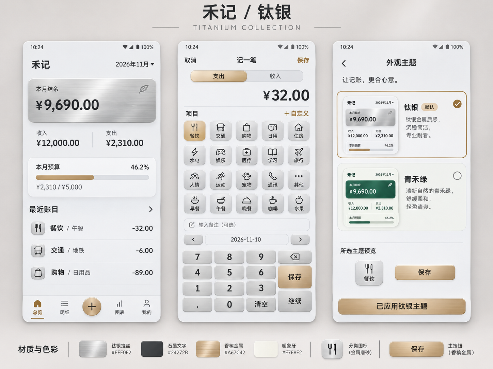
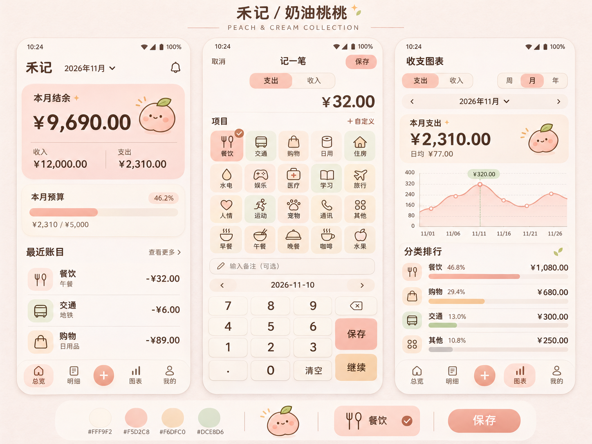

# 禾记 Android 0.3.0：钛银、奶油桃桃与主题切换

更新日期：2026-11-10。根据用户确认的 Sunburst 风格样板，将金属“钛银”和可爱“奶油桃桃”接入原生 APK，并保留“青禾绿”。

## 1. 安装包

| 项目 | 结果 |
|---|---|
| 文件 | `artifacts/Heji-0.3.0-debug.apk` |
| 版本 | `0.3.0` / versionCode `9` |
| 包名 | `com.simaoqingnian.myaccount` |
| 最低系统 | Android 8.0 / API 26；目标 API 35 |
| 大小 | 263,591 字节 |
| SHA-256 | `96173BD6799F2E5BF7067FC7E6C3D619E1A702D277D9C70069C37D6750B3476D` |
| 签名证书 SHA-256 | `0323C9F59297351811D628DD8176F6A6967DE7E7D0FF483949A08F62B4E730C7`，与旧版一致 |

## 2. 使用方式与主题范围

进入 **我的 → 外观主题**，点击带缩略图的主题卡即可应用，选择会记在本机。记账页顶部也提供“主题”入口，输入途中可进入选择，返回继续记账。

| 主题 | 外观 |
|---|---|
| 钛银（默认） | 浅银灰、水平拉丝、石墨文字；香槟金主要按钮与选中图标 |
| 奶油桃桃 | 奶油白、柔桃粉、淡杏和开心果绿；可可文字、圆角与原创桃子小表情 |
| 青禾绿 | 保留暖纸色与森林绿；次要文字略加深，提高可读性 |

主题覆盖总览、记账、明细、图表与历年账单、预算、我的、项目管理、原生弹窗与系统栏。切换只改变外观，真实金额仍来自用户账本；不会注入样板中的虚构账目。

总览按样板将月份移入标题栏，余额卡采用对应材质，预算卡改为紧凑的额度 / 使用比例。项目继续每行五列、40dp 图标容器，选中项加勾选标记；保留单条列表分隔线、数字键盘、“保存 / 继续”和日期前后按钮。历史备注仍在点击备注框后展开。

## 3. 对照样板落实与修正

- 两套初始风格图均使用用户指定的 `gpt-image-2.5-sunburst` 生成，Images API 首次调用成功。请求 2048 × 1536，服务实际返回 1448 × 1086，原图与提示词保存在 `design/themes/`。
- Android 与浏览器的调色板、原生资源样式、CSS 令牌和金属材质由同一脚本生成。金额采用深色实体文字；拉丝和高光只用于卡片、图标与按钮。
- 浏览器与 APK 共用钛银、香槟金的小尺寸材质图和桃子图案；检查了 APK 中三份 PNG 的实际像素，与浏览器引用文件一致。原生界面由可交互的 View / Canvas 构成，未将整张 AI 样板铺成页面。
- 对照后补齐选中图标勾选、桃桃主题杏色“继续”按钮、紧凑月份栏、原生主题缩略图和桃子图案。人工查看浏览器截图后修正缩略卡进度条溢出，并增加边界检查。
- 主文字、次文字、强调文字及卡片文字对比度均达到 4.5:1；原青禾绿次文字由 `#67766D` 加深为 `#627067`。金属渐变每一种像素底色也检查了深色文字对比度。

可打开 [三主题切换预览](../design/themes/preview.html)，或分别查看 [钛银浏览器截图](../design/themes/titanium/browser-preview.png) 与 [奶油桃桃浏览器截图](../design/themes/peach/browser-preview.png)。这些是浏览器样板截图，**不是 Android 设备截图**。

## 4. 状态与数据保留

主题偏好单独保存在 `appearance` / `theme`，默认 `titanium`，可选 `sage`、`peach`；未知值安全回退默认主题。主题切换通过页面保存状态与重建应用原生资源样式，记账页保留金额、备注、项目、日期、原账目 ID 和待保存状态；明细 / 图表保留筛选、周期、选中数据点及滚动位置。

包名、签名、`heji.db` 文件名和数据库版本 **2** 均沿用原版，账务与备份格式未改动。**请直接覆盖安装，不要先卸载或清除应用数据。** 构建继续核对原签名证书摘要。

## 5. 实际验证与边界

实际执行：

```powershell
python scripts/build-theme-assets.py
powershell -NoProfile -ExecutionPolicy Bypass -File scripts/build-android.ps1
python scripts/review-themes.py
powershell -NoProfile -ExecutionPolicy Bypass -File scripts/check-ledger.ps1
python scripts/check-upgrade.py
```

- Android 编译、资源处理、APK 打包通过；Lint **0 错误、0 警告**。
- 桌面账务规则 **100 项**、备份规则 **21 项**、SQLite 升级保留与签名保护 **16 项**通过。
- 共享主题资源与浏览器校对 **71 项**通过，包括三套调色板 / 原生资源样式、文字对比度、APK 素材像素、主题同步与记忆、示例输入保留、历史备注，以及 360 / 390 / 430px 下的五列项目、键盘按钮和主题卡可见性。
- APK 签名验证通过，包名、版本与系统要求核对一致。记录见 `design/themes/review-results.json`。

按用户此前要求，**未安装到手机或模拟器测试**。本次完成同源色彩 / 素材、浏览器外观与布局核对，以及原生编译和静态检查；原生整屏的字体、阴影、系统弹窗和主题切换恢复过程尚未做设备验证，不能将上述检查等同于实机逐像素一致性验证。

## 6. Sunburst 初始风格图

钛银金属主题：



奶油桃桃可爱主题：


