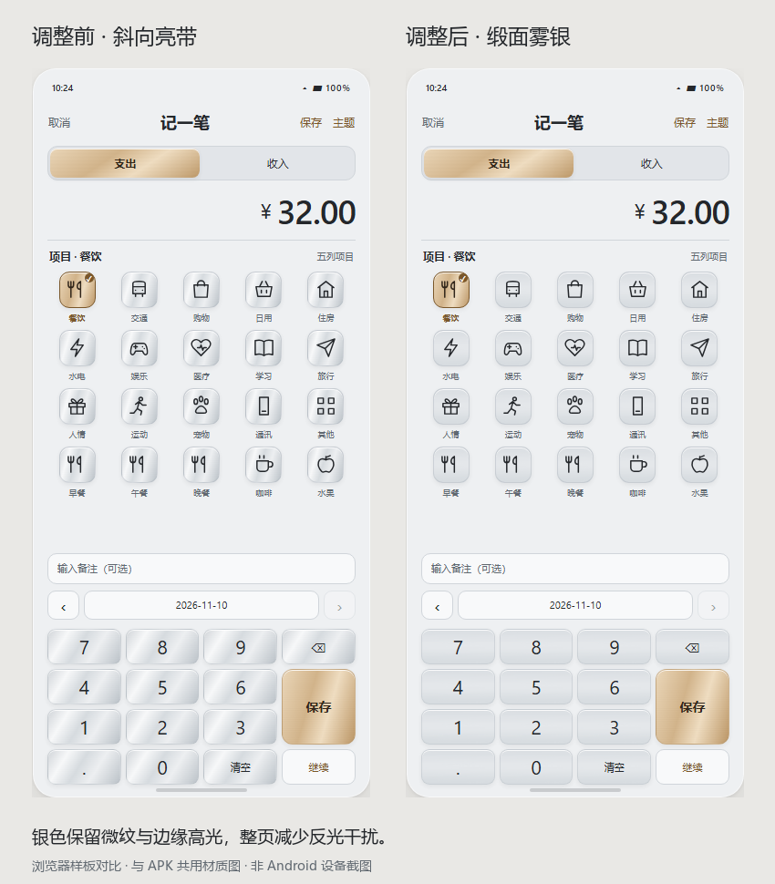

# 禾记 Android 0.3.1：缎面雾银材质

更新日期：2026-11-10。针对银色斜向亮带在分类宫格和数字键盘重复出现、整页反光过强的问题，将默认钛银主题调整为柔和的缎面雾银。

## 外观调整

- 银色卡片、分类格和数字键去掉斜向亮带，改用浅幅度的纵向明暗过渡与不规则横向微纹。
- 保留细边缘高光、浅浮雕和石墨色文字，以表面厚度和细微漫反射表达金属质感。
- 香槟金继续用于主要操作和选中项，奶油桃桃、青禾绿的材质与配色保留。
- 总览、记账页和主题选择缩略图同步调整；浏览器材质色块也直接引用同一张 PNG。
- 主题名称仍为“钛银”，已有选择自动沿用，无需重新设置。原 Sunburst 图作为初始设计参考保留，当前效果以新版样板为准。

[打开三主题预览](../design/themes/preview.html#titanium) · [查看整页截图](../design/themes/titanium/browser-preview.png)

上图为浏览器样板，金额为虚构示例，非 Android 设备截图。

## 安装包与升级

| 项目 | 结果 |
|---|---|
| 文件 | `artifacts/Heji-0.3.1-debug.apk` |
| 版本 | `0.3.1` / versionCode `10` |
| 大小 | 186,641 字节 |
| SHA-256 | `DC8D1C5B156E0E603557C6105C22CB3E14B9D909FDAEBC9D15B808F6F49FEDF0` |
| 签名证书 SHA-256 | `0323C9F59297351811D628DD8176F6A6967DE7E7D0FF483949A08F62B4E730C7` |
| 系统 | Android 8.0 / API 26 及以上；目标 API 35 |

包名、签名、`heji.db` 文件名和数据库版本 2 均沿用原版。账务逻辑、录入键盘、历史备注、连续记账和备份格式未修改。**直接覆盖安装，保留原有账目；不要先卸载或清除应用数据。** 安装升级过程仍未做设备验证。

## 验证范围

- Android 编译与打包通过，Lint 0 错误、0 警告；APK 签名验证通过，证书与旧版一致。
- 共享主题资源及浏览器检查 71 项通过；检查 APK 中三个素材的像素与浏览器引用一致，主要及次要文字对比度至少 4.5:1。
- 人工查看完整三屏样板和记账页前后对比，确认银色表面不再出现斜向亮带，细小按钮未形成重复的亮纹；主题缩略图同步更新。
- 桌面账务规则 100 项、备份规则 21 项、SQLite 升级保留及签名保护 16 项通过。

执行入口：`scripts/build-theme-assets.py`、`scripts/build-android.ps1`、`scripts/review-themes.py`、`scripts/check-ledger.ps1`、`scripts/check-upgrade.py`。主题检查记录见 `design/themes/review-results.json`。

按用户此前要求，**未安装到手机或模拟器测试**。原生与浏览器的材质图片已核对一致，浏览器的整页外观已查看；原生字体、阴影和系统界面的实际渲染仍以设备显示为准。
